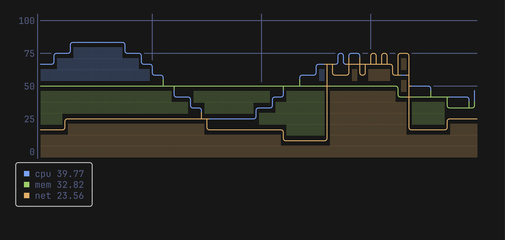

# Pulse

[](https://github.com/ingvarch/pulse/actions/workflows/ci.yml)
[](https://pkg.go.dev/github.com/ingvarch/pulse)
[](https://goreportcard.com/report/github.com/ingvarch/pulse)
[](go.mod)
[](https://github.com/ingvarch/pulse/releases)
[](LICENSE)

Pulse is a Go library that draws live line charts in the terminal. It is for developers who build terminal apps with Charm's [Lip Gloss](https://github.com/charmbracelet/lipgloss) and [Bubble Tea](https://github.com/charmbracelet/bubbletea): you push values, and `View()` returns a chart that slides left as new points arrive, drawn with box-drawing curves or braille dots. Pulse is made by [Igor Churmeev](https://github.com/ingvarch).

<p align="center">
  
</p>

## Features

- Smooth box-drawing curves, thin and rounded or bold, or braille dots with spline smoothing for a denser line.
- Several named series on one chart, each with its own Lip Gloss style, and a legend box with the latest values.
- Area fill under the curves, stippled, tinted or solid, over a grid aligned to the Y ticks.
- Charts around zero: a zero baseline, mirrored series such as network RX and TX, a symmetric range and byte-rate labels.
- Events such as deploys and alerts, pinned to points on the timeline with a marker and a vertical line.
- An optional time axis with labels from your own function, at the quarter columns or at the columns you choose.
- Gaps for missing samples: `NaN` and `±Inf` draw nothing.

## Usage

```bash
go get github.com/ingvarch/pulse
```

```go
chart := pulse.New(80, 13, pulse.WithRange(0, 100))
for i := 0; i < 80; i++ {
	chart.Push(50 + 38*math.Sin(float64(i)*0.16))
}
fmt.Println(chart.View())
```

## Quick Start

You need Go 1.26 or newer, see [docs/development.md](docs/development.md).

```bash
git clone https://github.com/ingvarch/pulse.git
cd pulse
go test ./...
go -C examples run ./livedemo
```

## Documentation

- [Getting Started](docs/getting-started.md): install, the sliding window, history and resizing, missing points, several series, styling and themes, legends, runtime settings
- [Rendering Modes](docs/rendering-modes.md): box-drawing curves, braille dots, area fill
- [Axes and Grid](docs/axes-and-grid.md): Y ticks, the grid, the time axis, symmetric range, label formatters
- [Zero-Crossing and RX/TX](docs/zero-crossing-fill.md): zero baseline, mirrored series, negative styles, byte-rate labels
- [Timeline Events](docs/timeline-events.md): deploys and alerts on the chart, the events card
- [Bubble Tea Integration](docs/bubbletea.md): a chart inside a Bubble Tea model, ticks, hotkeys, resizing
- [Development](docs/development.md): checks, demos, screenshots, releases, project structure
- [API reference](https://pkg.go.dev/github.com/ingvarch/pulse) on pkg.go.dev

## License

MIT, see [LICENSE](LICENSE).

## Contributing

See [CONTRIBUTING.md](CONTRIBUTING.md) and the [Code of Conduct](CODE_OF_CONDUCT.md). Report security issues privately, as [SECURITY.md](SECURITY.md) describes.
