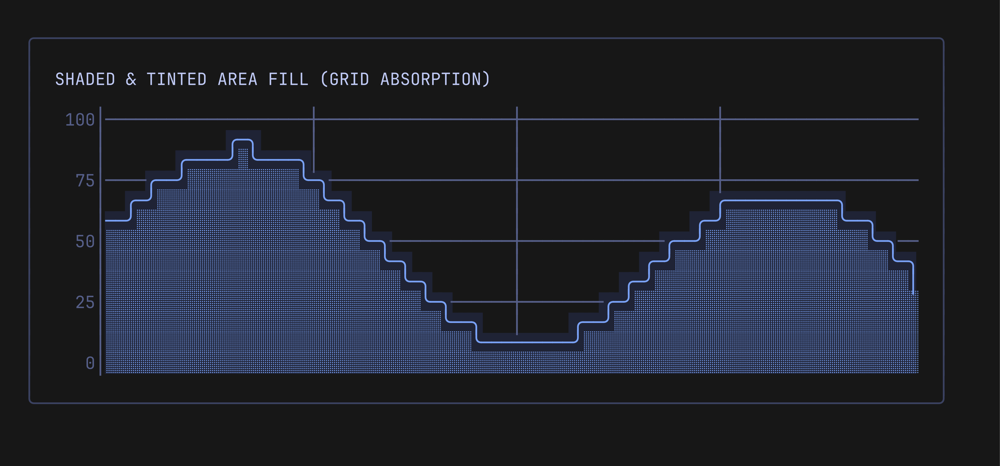
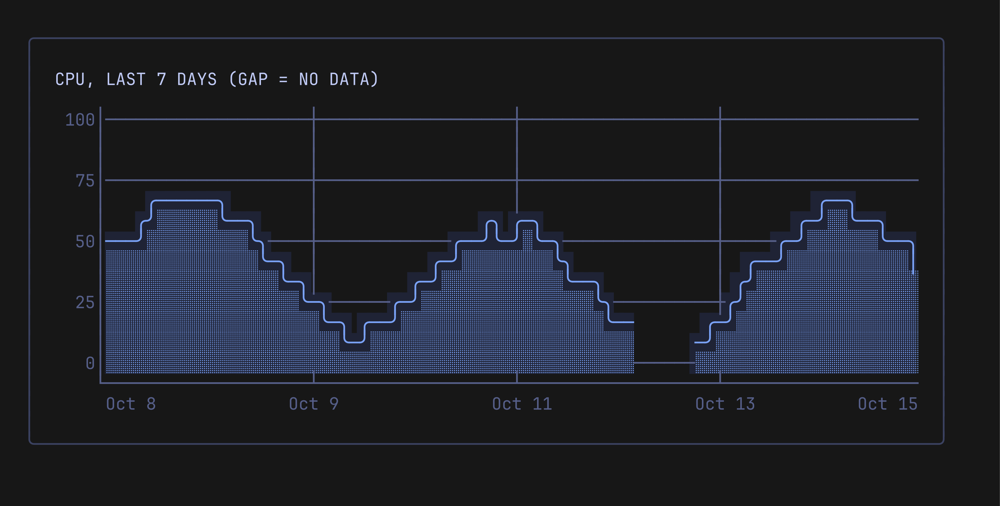
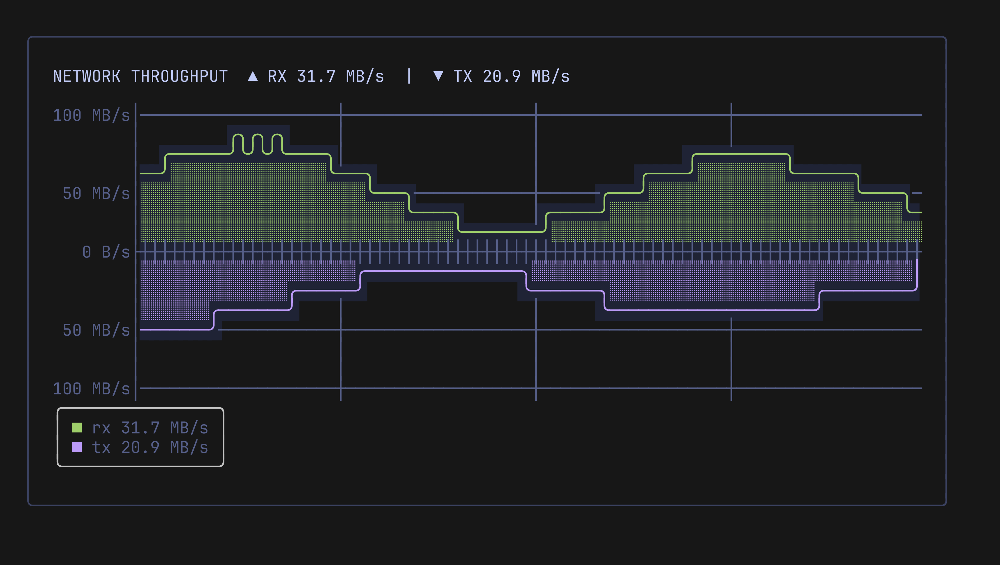

# Axes, Scales & Grid Alignment

## Y-Axis Auto-Scaling (`NiceTicks`)

By default, Pulse calculates visually balanced tick intervals using the **Nice Numbers** algorithm (`scale.NiceTicks`).

```go
chart := pulse.New(60, 10, pulse.WithRange(0, 100))
```

The algorithm adapts to chart height, picking clean, human-friendly steps such as multiples of 1, 2, 5, 10, 20, 25, or 50.

## Custom Ticks

For fixed ranges (e.g. CPU or RAM percent `0%..100%`), you can specify explicit quarter-step ticks:

```go
chart := pulse.New(60, 13,
    pulse.WithRange(0, 100),
    pulse.WithTicks(0, 25, 50, 75, 100),
)
```

> [!TIP]
> For perfectly even row spacing across 5 ticks (`0, 25, 50, 75, 100`), use a height of `13` terminal rows. Each quarter-step will be spaced exactly 3 terminal rows apart (`12 / 4 = 3`).

## Grafana-Style Coordinate Grid

When `pulse.WithGrid(true)` is enabled:
- **Horizontal lines**: Drawn as subtle `─` aligned precisely with each Y-axis label.
- **Vertical lines**: Drawn at quarter intervals of chart width (`w / 4`, `2w / 4`, `3w / 4`).
- **Intersections**: Rendered with `┼`.
- **Faint styling**: Grid lines automatically inherit `axisStyle.Faint(true)` so they remain visually subtle beneath data curves.

```go
chart := pulse.New(60, 12,
    pulse.WithGrid(true),
    pulse.WithAxisStyle(lipgloss.NewStyle().Foreground(lipgloss.Color("#444b6a"))),
)
```

<p align="center">
  
</p>

## Time Axis (`WithXAxis`)

`pulse.WithXAxis(label)` draws an axis row and a label row under the plot. `label(age)` returns the text for the point `age` steps before the newest one, so age 0 is the newest point. The function runs on every `View()` and gets only the age. To keep the labels with the data, compute them from the time of the newest point and update that time on each push.

```go
var newest time.Time            // time of the newest point
step := 7 * 24 * time.Hour / 60 // 60 points cover 7 days

chart := pulse.New(60, 10,
    pulse.WithRange(0, 100),
    pulse.WithXAxis(func(age int) string {
        return newest.Add(-time.Duration(age) * step).Format("Jan 2")
    }),
)

// For each sample:
newest = sample.Time
chart.Push(sample.Value)
```

Labels sit at the left edge, the right edge, and at the quarter columns (`w / 4`, `2w / 4`, `3w / 4`), the same columns as the vertical grid. The left label starts at column 0, the right label ends at the last column, and the middle labels are centered on their column with a `┴` mark on the axis row.

- An empty string means no label and no mark at that column.
- A label that does not fit inside the plot width is dropped.
- Labels keep at least one space between them. The right edge is placed first, then the left edge, then the quarters. A label that would touch one already placed is dropped, so narrow charts show only the edge labels.

`Height()` stays the plot height. With the axis on, `View()` returns `Height()+2` lines: the plot rows, the axis row, and the label row. Leave room for the two extra lines when you lay the chart out. The axis rows do not depend on the grid, the render mode, or events. `chart.SetXAxis(nil)` turns the axis off.

<p align="center">
  
</p>

## Symmetric Y-Axis (`WithSymmetric`)

When plotting bidirectional metrics (such as network RX/TX, disk read/write, or profit/loss), you often need zero to stay directly in the vertical center of the chart with equal positive and negative scaling.

`pulse.WithSymmetric(true)` normalizes bounds to $[-\text{limit}, +\text{limit}]$ where $\text{limit} = \max(|min|, |max|)$:

```go
chart := pulse.New(60, 13,
    pulse.WithRange(0, 100),   // Automatically normalized to [-100, +100]
    pulse.WithSymmetric(true),
    pulse.WithZeroBaseline(true),
)
```

<p align="center">
  
</p>

You can also dynamically toggle symmetry at runtime via `chart.SetSymmetric(bool)` or inspect it with `chart.Symmetric() bool`.

## Label Formatters & Network Rates (`scale`)

Custom tick labels can be formatted using `pulse.WithLabelFormatter(...)`. The `scale` package provides built-in formatters for human-readable bytes and throughput rates:

```go
import "github.com/ingvarch/pulse/scale"

// 1. Throughput rates with sign (e.g. "+50 MB/s", "-25 MB/s")
pulse.WithLabelFormatter(scale.FormatBytesRate)

// 2. Mirrored absolute throughput rates without minus sign (e.g. "50 MB/s" for both RX and TX)
pulse.WithLabelFormatter(scale.FormatBytesRateAbs)

// 3. Or use the configurable helper:
pulse.WithLabelFormatter(scale.BytesRateFormatter(true)) // true for absolute, false for signed
```

For static data size metrics (RAM, disk space), `scale.FormatBytes` formats values as `"512 B"`, `"1.5 KB"`, `"10 MB"`, `"2 GB"`, etc.

