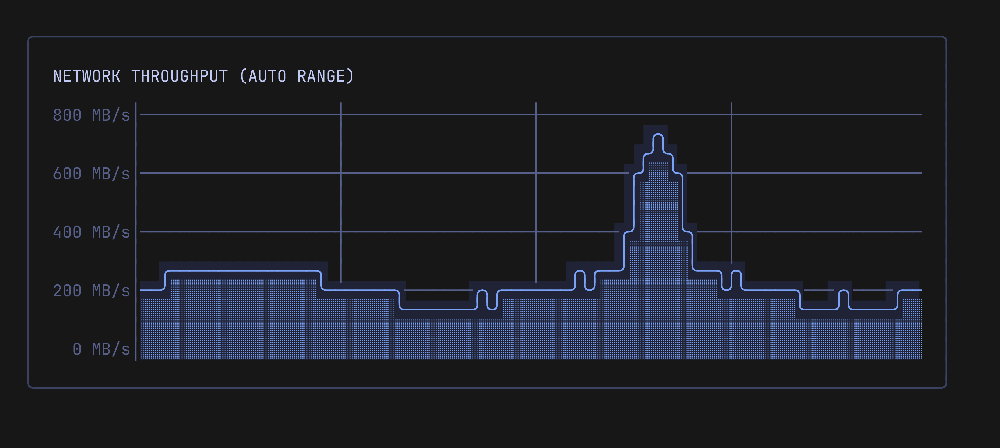
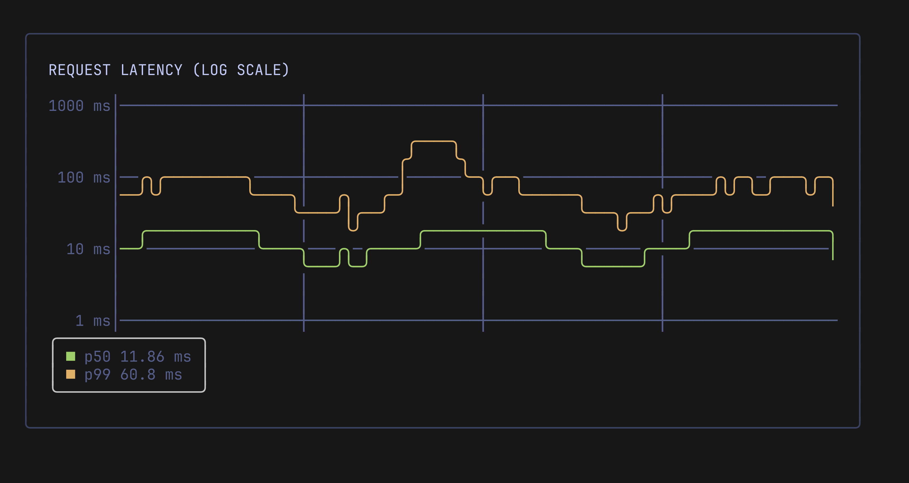
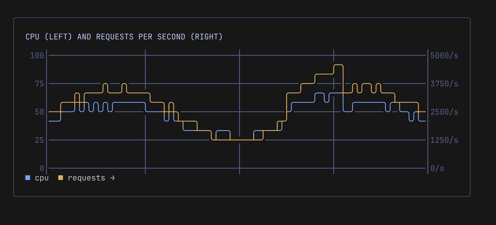
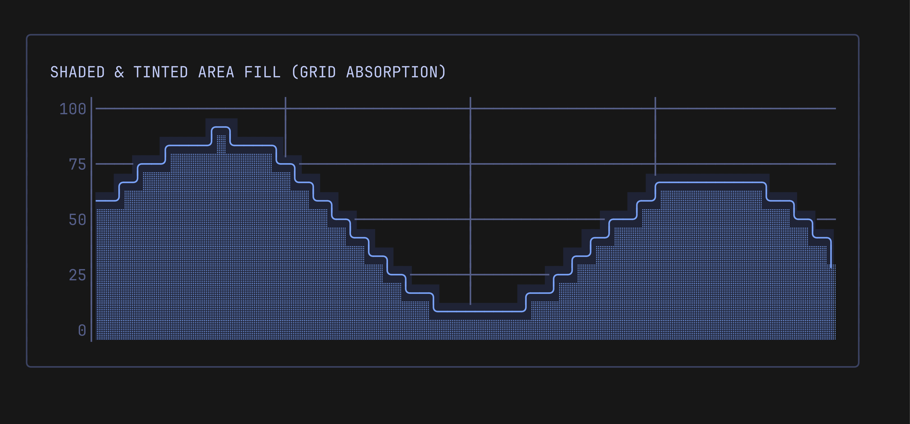
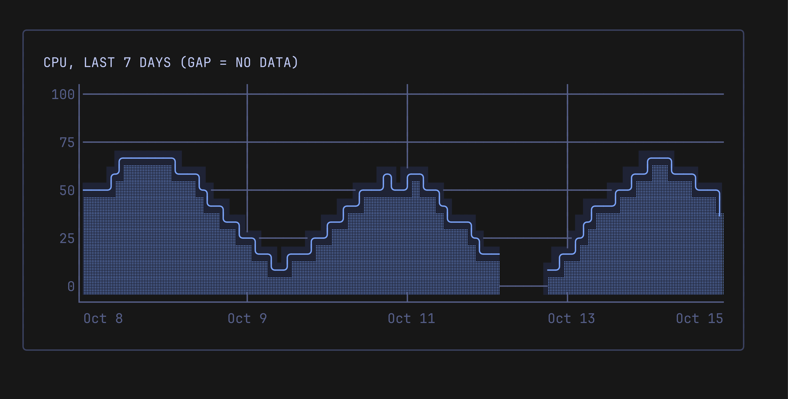
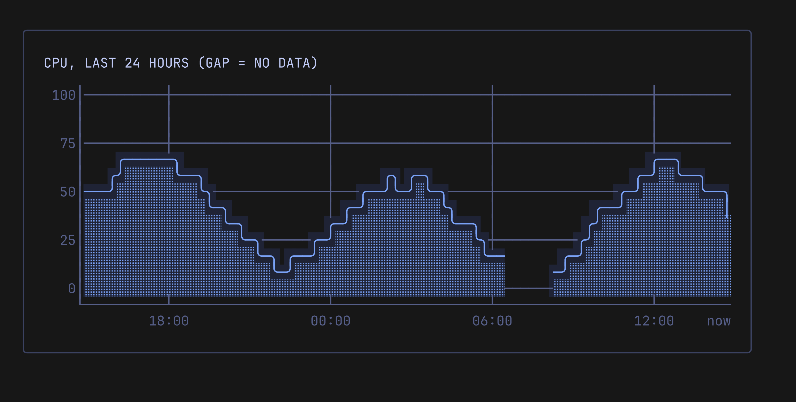
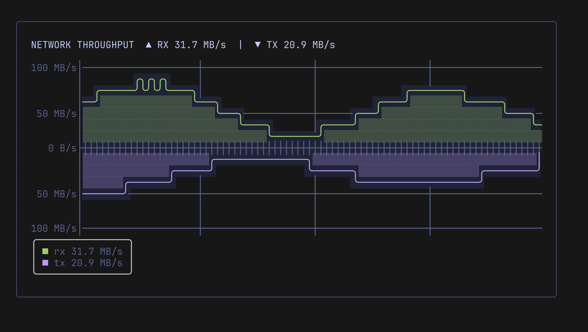

# Axes, Scales & Grid Alignment

## Y-Axis Ticks (`NiceTicks`)

By default, Pulse calculates visually balanced tick intervals using the **Nice Numbers** algorithm (`scale.NiceTicks`).

```go
chart := pulse.New(60, 10, pulse.WithRange(0, 100))
```

The algorithm adapts to chart height, picking clean, human-friendly steps such as multiples of 1, 2, 5, 10, 20, 25, or 50.

`WithRange` and `SetRange` ignore a call with a NaN or infinite bound and keep the current range, which is `0..100` on a new chart. A call that sets the range turns [auto range](#automatic-range) off.

## Automatic Range

`WithAutoRange(true)` fits the Y range to your data, so you do not call `SetRange` on every push. Use it for metrics without a fixed scale, such as network throughput or latency.

```go
chart := pulse.New(80, 13, pulse.WithAutoRange(true))
chart.Push(120)
chart.Push(730)
chart.View()
fmt.Println(chart.Min(), chart.Max()) // 0 800
```

<p align="center">
  
</p>

- `View` computes the range from the finite values in the visible window (the last `Width()` points, or the points the [offset](cursor-and-scrolling.md#offset) scrolled to) of all series except those on the [right axis](#right-axis), the default series included. A spike leaves the range when it scrolls out of the window.
- Gaps (NaN, +Inf, -Inf) are ignored.
- 0 always stays inside the range. A chart of positive values starts at 0. (On a [log scale](#logarithmic-scale) the range is in whole decades instead.)
- The bounds are rounded out with `scale.NiceRange`, so the top and the bottom are tick values and both get a label.
- An inverted series counts with its sign flipped, as it is drawn.
- With `WithSymmetric(true)` the range is `[-a, +a]`, where `a` is the largest absolute value.
- With no finite values, or with a flat line at 0, the range is `0..1` (`-1..1` when symmetric).
- With `WithTicks`, auto range still sets the range. Only the ticks inside it get a label.
- `Min()` and `Max()` return the range of the last `View`, and the initial range before the first `View`. Renderers draw against it, except on a [log scale](#logarithmic-scale).
- `WithRange` and `SetRange` turn auto range off. `WithAutoRange(true)` after `WithRange` turns it on again. `WithSymmetric` and `SetSymmetric` leave it as it is.
- `SetAutoRange(false)` keeps the range of the last render. `AutoRange()` reports the state.
- The label column gets wider when a longer label appears, for example when `750` becomes `1000`. To keep the chart width fixed, set `WithLabelWidth` to the widest label you expect.

## Logarithmic Scale

`WithLogScale(true)` maps values to rows by their base-10 logarithm. Use it for metrics that span orders of magnitude, such as latency, where a p99 is a hundred times the median and a linear scale presses the normal traffic against the bottom row.

```go
chart := pulse.New(80, 13,
	pulse.WithLogScale(true),
	pulse.WithAutoRange(true),
	pulse.WithLabelFormatter(func(v float64) string { return scale.FormatTick(v) + " ms" }),
)
chart.PushSeries("p50", 12)
chart.PushSeries("p99", 300)
```

<p align="center">
  
</p>

- `SetLogScale(on)` switches it at run time and `LogScale()` reports it. Turning it off restores the linear chart with the stored range unchanged.
- Values at or below zero are drawn as gaps, like NaN. `Push`, `Last` and `SeriesData` keep the real values.
- Both range bounds must be above zero. A non-positive minimum becomes `max / 10`. When both bounds are non-positive, the range is `1..10`. `Min()` and `Max()` still return the stored range: the fix-ups apply when drawing.
- With [auto range](#automatic-range), the range covers the positive finite values in the window, rounded out to whole decades with `scale.LogRange`: 5 and 300 give `1..1000`. When both ends are the same power, the top is ten times the bottom. With no positive values the range is `1..10`.
- Ticks are the powers of ten inside the range. With fewer than two, the 2x and 5x values of each decade are added, so `2..8` gets 2 and 5. With more than the chart height allows, every k-th tick is kept, counted from the lowest power of ten. `scale.LogTicks` computes them.
- `WithTicks` works as on the linear scale: a tick at or below zero, or outside the range, gets no label. The label formatter gets the real value (10, 100, 1000), not the logarithm.
- [Thresholds](thresholds.md) use the same mapping. A threshold with `Value <= 0` draws no line and colors nothing.
- The fill goes down to the bottom row.
- The zero baseline, the symmetric range (a fixed range stays as set, for example `1..1000`), inverted series, negative styles and zero-crossing fill are ignored on a log scale. An inverted series is drawn at its real positive values, except on the [right axis](#right-axis).
- Events, the time axis, gaps and legends work as on the linear scale.
- A custom renderer gets a `Chart` whose `Min()` and `Max()` are `0` and the number of decades, and whose series values are `log10(v / lo)`, where `lo` is the bottom of the range.

## Right Axis

`WithRightAxis` adds a second Y axis on the right, with its own range and labels. Use it for two metrics on different scales, such as CPU in percent and requests per second.

```go
chart := pulse.New(80, 13,
	pulse.WithRange(0, 100),
	pulse.WithRightAxis(pulse.Axis{
		Min: 0, Max: 5000,
		Formatter: func(v float64) string { return fmt.Sprintf("%.0f/s", v) },
	}),
)
chart.PushSeries("cpu", 42)
chart.PushSeries("requests", 2100)
chart.SetSeriesRightAxis("requests", true)
```

<p align="center">
  
</p>

- `Axis` has `Min`, `Max`, optional `Ticks` and an optional `Formatter`. Without ticks, `scale.NiceTicks` picks them. Without a formatter, `scale.FormatTick` formats the labels.
- `WithSeriesRightAxis(name)` or `SetSeriesRightAxis(name, on)` plots a series against the right range. `SeriesRightAxis(name)` and `RightAxis()` read the settings back. A series flagged for the right axis stays on the left until an axis is set.
- `SetRightAxis` ignores a call with a NaN or infinite bound. A `Min` above `Max` is swapped, and equal bounds widen to `Min..Min+1`. The right range is fixed and linear, also on a log scale.
- The plot stays `w` wide. Every line of `View` gets one cell for the axis line plus a label column as wide as the widest right label, so all lines have the same width. The height does not change. The time axis rows keep their alignment with the plot and are padded to the same width.
- A right label sits on the row of its own tick. A tick outside the right range gets no label, and when two ticks share a row the higher one wins, as on the left.
- The horizontal grid follows the left ticks only, so a right label can sit on a row without a grid line.
- `Legend` and `LegendBox` add ` →` after the name of a right-axis series.
- Values outside the right range are clamped to the top or bottom row. Gaps stay gaps. An inverted series is negated before it is mapped, also on a log scale.
- [Auto range](#automatic-range), the zero baseline and the symmetric range use the left axis only. [Thresholds](thresholds.md) and threshold colors do not color a right-axis series, and neither do negative styles: its cells below the zero row keep the series style.
- The fill of a right-axis series goes down to the same baseline row as the fill of a left series.
- A custom renderer gets right-axis values mapped into the left range in `ctx.SeriesData` and `Chart.SeriesData`. `SeriesInverted` is false for them, and `ctx.RightAxis` marks them.
- When the time axis is on, its axis row ends with `┘` under the right axis line.
- Both render modes, events, the time axis, gaps, history and `SetSize` work as without a right axis.

## Custom Ticks

For fixed ranges (e.g. CPU or RAM percent `0%..100%`), you can specify explicit quarter-step ticks:

```go
chart := pulse.New(60, 13,
    pulse.WithRange(0, 100),
    pulse.WithTicks(0, 25, 50, 75, 100),
)
```

> [!TIP]
> For perfectly even row spacing across 5 ticks (`0, 25, 50, 75, 100`), use a height of `13` terminal rows. Each quarter-step will be spaced exactly 3 terminal rows apart (`12 / 4 = 3`).

## Grafana-Style Coordinate Grid

The grid is on by default; `pulse.WithGrid(false)` turns it off. With the grid on:
- **Horizontal lines**: Drawn as subtle `─` aligned precisely with each Y-axis label.
- **Vertical lines**: Drawn at quarter intervals of chart width (`w / 4`, `2w / 4`, `3w / 4`). With `WithXAxisAt`, they are drawn at the columns of the placed middle time labels instead.
- **Intersections**: Rendered with `┼`.
- **Faint styling**: Grid lines automatically inherit `axisStyle.Faint(true)` so they remain visually subtle beneath data curves.

```go
chart := pulse.New(60, 12,
    pulse.WithGrid(true),
    pulse.WithAxisStyle(lipgloss.NewStyle().Foreground(lipgloss.Color("#444b6a"))),
)
```

<p align="center">
  
</p>

## Time Axis (`WithXAxis`)

`pulse.WithXAxis(label)` draws an axis row and a label row under the plot. `label(age)` returns the text for the point `age` steps before the newest one, so age 0 is the newest point. The function runs on every `View()` and gets only the age. To keep the labels with the data, compute them from the time of the newest point and update that time on each push.

```go
var newest time.Time            // time of the newest point
step := 7 * 24 * time.Hour / 60 // 60 points cover 7 days

chart := pulse.New(60, 10,
    pulse.WithRange(0, 100),
    pulse.WithXAxis(func(age int) string {
        return newest.Add(-time.Duration(age) * step).Format("Jan 2")
    }),
)

// For each sample:
newest = sample.Time
chart.Push(sample.Value)
```

Labels sit at the left edge, the right edge, and at the quarter columns (`w / 4`, `2w / 4`, `3w / 4`), the same columns as the vertical grid. The left label starts at column 0, the right label ends at the last column, and the middle labels are centered on their column with a `┴` mark on the axis row.

- An empty string means no label and no mark at that column.
- A label that does not fit inside the plot width is dropped.
- Labels keep at least one space between them. The right edge is placed first, then the left edge, then the quarters. A label that would touch one already placed is dropped, so narrow charts show only the edge labels.

`Height()` stays the plot height. With the axis on, `View()` returns `Height()+2` lines: the plot rows, the axis row, and the label row. Leave room for the two extra lines when you lay the chart out. The axis rows do not depend on the grid, the render mode, or events. `chart.SetXAxis(nil)` turns the axis off.

<p align="center">
  
</p>

The label function always gets the real age of a column, also while the view is scrolled. See [Cursor and Scrolling](cursor-and-scrolling.md).

## Labels at Chosen Columns (`WithXAxisAt`)

`WithXAxis` puts labels at the edges and the quarter columns, so they show whatever time falls there, for example `12:45  18:33  00:37  06:41  now`. `pulse.WithXAxisAt(label)` draws the same two rows, but asks `label` for every column, ages `offset` to `offset+w-1` (0 to `w-1` at offset 0). A non-empty text proposes a label at that column. To get round times, return text only for the column that holds one:

```go
var newest time.Time        // time of the newest point
step := 24 * time.Hour / 80 // 80 points cover 24 hours

chart := pulse.New(80, 13,
    pulse.WithRange(0, 100),
    pulse.WithXAxisAt(func(age int) string {
        if age == 0 {
            return "now"
        }
        t := newest.Add(-time.Duration(age) * step)
        // The last 6-hour mark on the clock of t's time zone; the column holds it if it falls in (t-step, t].
        mark := time.Date(t.Year(), t.Month(), t.Day(), t.Hour()/6*6, 0, 0, 0, t.Location())
        if t.Sub(mark) < step {
            return mark.Format("15:04")
        }
        return ""
    }),
)
```

- Labels are aligned as with `WithXAxis`: the left edge label starts at column 0, the right edge label ends at the last column, and the others are centered on their column with a `┴` mark.
- The right edge is placed first, then the other columns from right to left. A label that would run past an edge or touch one already placed is dropped, so when the candidates are too close, the newer ones stay. Pick a step that leaves room: a 5-character label needs 6 columns.
- The vertical grid lines follow the placed middle labels instead of the quarters. The edge labels get no grid line, so with no middle labels there are no vertical grid lines.
- `t.Truncate(6 * time.Hour)` rounds in UTC, not in the time zone of `t`. Build the mark from the wall clock, as above, so the labels read `18:00` and not `17:30` in a zone with a half-hour offset.
- `label` runs `w` times on every `View()`, so keep it cheap.
- `chart.SetXAxisAt(nil)` turns the axis off. `SetXAxis` and `SetXAxisAt` replace each other.

<p align="center">
  
</p>

## Symmetric Y-Axis (`WithSymmetric`)

When plotting bidirectional metrics (such as network RX/TX, disk read/write, or profit/loss), you often need zero to stay directly in the vertical center of the chart with equal positive and negative scaling.

`pulse.WithSymmetric(true)` normalizes bounds to $[-\text{limit}, +\text{limit}]$ where $\text{limit} = \max(|min|, |max|)$:

```go
chart := pulse.New(60, 13,
    pulse.WithRange(0, 100),   // Automatically normalized to [-100, +100]
    pulse.WithSymmetric(true),
    pulse.WithZeroBaseline(true),
)
```

<p align="center">
  
</p>

You can also dynamically toggle symmetry at runtime via `chart.SetSymmetric(bool)` or inspect it with `chart.Symmetric() bool`.

## Label Formatters & Network Rates (`scale`)

Custom tick labels can be formatted using `pulse.WithLabelFormatter(...)`. The `scale` package provides built-in formatters for human-readable bytes and throughput rates:

```go
import "github.com/ingvarch/pulse/scale"

// 1. Throughput rates with sign (e.g. "+50 MB/s", "-25 MB/s")
pulse.WithLabelFormatter(scale.FormatBytesRate)

// 2. Mirrored absolute throughput rates without minus sign (e.g. "50 MB/s" for both RX and TX)
pulse.WithLabelFormatter(scale.FormatBytesRateAbs)

// 3. Or use the configurable helper:
pulse.WithLabelFormatter(scale.BytesRateFormatter(true)) // true for absolute, false for signed
```

For static data size metrics (RAM, disk space), `scale.FormatBytes` formats values as `"512 B"`, `"1.5 KB"`, `"10 MB"`, `"2 GB"`, etc.

