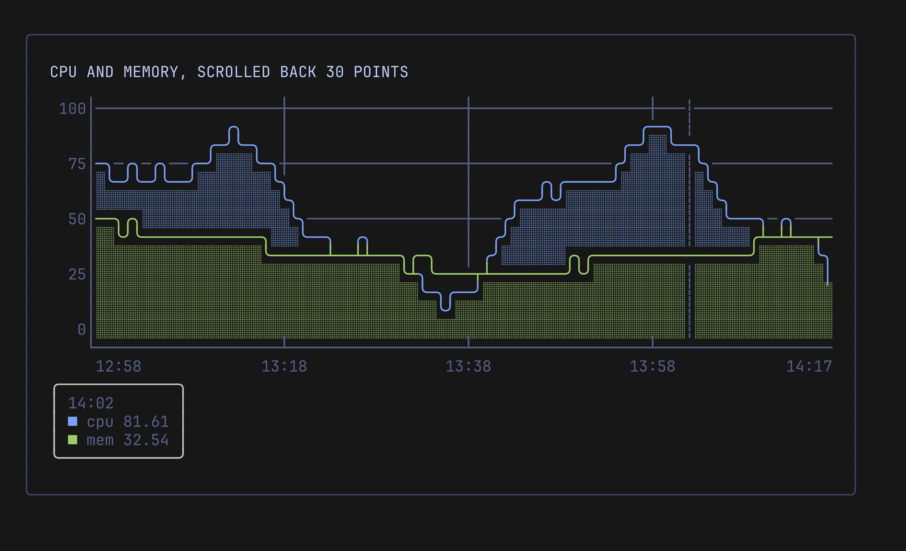

# Cursor and Scrolling

The legend shows the newest value. The cursor shows the value of every series at an older point, and the offset scrolls the view back into the history.

Pulse does not read keys or the mouse. It gives you methods, and your app binds them to input. Keep the points with `WithHistory(n)`, or there is nothing to scroll back to.

<p align="center">
  
</p>

## Usage

```go
chart := pulse.New(80, 13,
	pulse.WithHistory(1000),
	pulse.WithXAxis(label),
)

chart.SetCursor(45)  // the point 45 steps before the newest
chart.SetOffset(30)  // the view ends 30 points before the newest

values := chart.CursorValues() // map[series]value, NaN for a gap
fmt.Println(chart.View())
fmt.Println(chart.CursorBox())  // the X axis label and each value

chart.SetCursor(-1) // hide the cursor
chart.SetOffset(0)  // follow the newest point again
```

## Cursor

- `SetCursor(age)` shows the cursor at the point `age` steps before the newest one. `0` is the newest point. An age below `-1` hides it, as `-1` does. `Cursor()` returns the age, or `-1`.
- The cursor is a `┆` in the axis style in its column, on every plot row.
- A cursor outside the visible window draws nothing, and `CursorValues` still works while the point is in the history. There is no upper limit on the age.
- `CursorValues` returns `nil` while the cursor is hidden. Otherwise it has one entry per series, and the default series once it has data. The value is the one you pushed: not negated for an inverted series and not changed by the log scale. A gap, or a series shorter than the age, gives `NaN`.
- `CursorBox` returns `""` while the cursor is hidden. Otherwise it is a small card in the style of `LegendBox`: the X axis label at the cursor, when an X axis is set and the label is not empty, then a line per series with its swatch, name and value. Values use the label formatter, and a series on the right axis gets ` →`. The default series has no name, so its line is the swatch and the value. A gap has no value after the swatch.

## Offset

- `SetOffset(n)` scrolls the view `n` points back. It is clamped to `0` through the longest series length minus the width, so the oldest point can reach the left edge and no further. `Offset()` returns it.
- A series with fewer points than the offset shows nothing.
- While the offset is above zero, each step raises it by one, so the view stays on the same points. A step is defined below. A cursor that is not hidden moves with it, so it stays on the same point. At offset `0` the cursor keeps its age.
- When the history is full, the clamp stops the offset, and the view moves with the new data.
- `SetSize` and `SetHistory` clamp the offset again.
- The offset moves once per step: on a push to the default series, or, while the default series has no data, on a push to the first named series. So it moves once per sample, however many series you push. If the series that moves it is shorter than another one and the offset is at its limit, the view of the longer series shifts by one point for that step.

## What Follows the Offset

Everything that draws shows the scrolled window: series, auto range, log scale, the right axis, thresholds and events.

- Ages stay relative to the newest point. The X axis label function gets the real age of each column, and `VisibleEvent.Age` is the real age of the event. An event drawn at column `w-1-(age-offset)` is hidden when it is newer or older than the window.
- `SeriesData` and `LenSeries` return the visible window.
- `Last` and the legends keep showing the newest values.

## Drawing Order

The cursor is drawn where event guidelines are, just behind them. From front to back:

- `ModeLines`: event pins, the series line, event guidelines, the cursor, the area fill, threshold lines, the zero baseline and the grid. On a tinted fill the cursor gets the tint as its background.
- `ModeBraille`: event pins, the series line and its fill dots, event guidelines, the cursor, threshold lines, the zero baseline and the grid. With fill on, the fill dots hide the cursor below the line.

A custom renderer gets the column in `RenderContext.CursorCol`, or `-1`, and draws the cursor itself.

## Keys in Bubble Tea

See [Bubble Tea Integration](bubbletea.md#cursor-and-scrolling) for a key binding sample, and `examples/livedemo` for the full demo.
