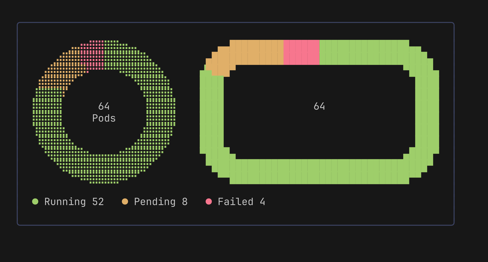

# Donut

The `donut` package draws the parts of a whole at one moment, for example Kubernetes pods by phase. Sections go around a ring or a rectangular frame, and the total sits in the middle. The line chart `Model` does not change: `donut` is a separate package that imports only Lip Gloss.

<p align="center">
  
</p>

## Usage

```go
package main

import (
	"fmt"

	"charm.land/lipgloss/v2"
	"github.com/ingvarch/pulse/donut"
)

func main() {
	green := lipgloss.NewStyle().Foreground(lipgloss.Color("#9ece6a"))
	yellow := lipgloss.NewStyle().Foreground(lipgloss.Color("#e0af68"))
	red := lipgloss.NewStyle().Foreground(lipgloss.Color("#f7768e"))

	d := donut.New(12, // height in rows; a ring is twice as many columns wide
		donut.WithCenterLabel("Pods"),
		donut.WithGlyphs(donut.Octants),
	)
	d.SetSections(
		donut.Section{Name: "Running", Value: 52, Style: green},
		donut.Section{Name: "Pending", Value: 8, Style: yellow},
		donut.Section{Name: "Failed", Value: 4, Style: red},
	)
	fmt.Println(d.View())   // the ring, with "64" and "Pods" inside
	fmt.Println(d.Legend()) // ● Running 52   ● Pending 8   ● Failed 4
}
```

`SetSections` copies the slice. Call it again when the values change. `SetGlyphs` and `Glyphs` change and read the glyph set at run time.

## Shapes

- Ring (default): `New(h)` draws a ring `h` rows tall and `2h` columns wide. The inner radius is 60% of the outer one.
- Frame: `WithFrame(w, h, thickness, radius)` replaces the ring by a rectangle border of `w` columns and `h` rows. The frame's `w` and `h` set the size, and the `h` given to `New` is not used. `thickness` and `radius` are in columns. The border looks equally thick on all sides: `thickness` columns at the left and right, and half as many rows at the top and bottom. Radius 0 gives square corners. Thickness is at least 1, and thickness and radius are cut down to what fits.

`View` returns exactly `h` lines of equal width: `2h` for a ring, `w` for a frame.

## Glyph Sets

| Set | Sub-pixels per cell | Colors per cell | Where it works |
| --- | ------------------- | --------------- | -------------- |
| `Braille` (default) | 2x4 | 1 | Nearly every terminal and font |
| `Octants` | 2x4 | 2 | Terminals that draw block characters themselves (Ghostty, Kitty, WezTerm), or fonts with the Unicode 16 octant block (U+1CD00 to U+1CDE5) |
| `HalfBlocks` | 1x2 | 2 | Everywhere |

Octants give the smoothest edges. Elsewhere they show as missing glyphs, so pulse does not pick them for you: set `WithGlyphs(donut.Octants)` when you know the terminal. `Braille` takes the section with more dots in a cell where sections meet. `HalfBlocks` is enough for a frame with square corners.

## Rules

- Sections go clockwise from 12 o'clock, the top center of a frame, in the order given.
- A section with a value of 0 or below, `NaN` or `Inf` is not drawn. It stays in the legend with the value as given.
- A drawn section always gets a visible arc, at least 2 columns long on the middle line of the shape. So 1 Failed out of 500 still shows, and the other sections shrink to make room. The legend shows the exact values.
- In a cell where several sections meet, the sections with the most sub-pixels take it. Two-color sets keep the two largest parts of the cell, counting the empty part as one; the rest joins the larger section. Braille takes the section with the most dots.
- Colors come from the foreground of each section's style, so ANSI palette colors work as well as true color.
- The center shows the total in bold and the label under it. Each line is left out when it would cover the shape; if the total does not fit, both go. A label with a line break is left out. The total is the plain float sum of the drawn values, so fractions can print long (`0.30000000000000004`) and then do not fit.
- With a total of 0, or no sections, the shape is drawn in one faint style and the center shows `0`.
- Numbers in the center and the legend print with the shortest exact form, so `1.5` stays `1.5`.

## Legend

`Legend()` returns one line: `● Name Value` for each section, separated by three spaces. The dot uses the section style. It returns `""` when there are no sections.

## Demo

`go -C examples run ./donut` shows pods by phase that change every second, as a ring and a frame. `g` cycles the glyph sets.
