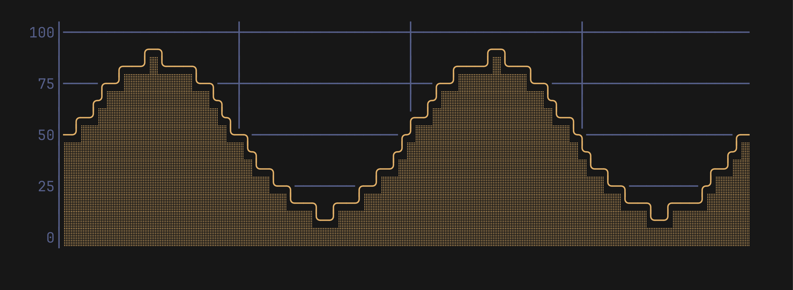
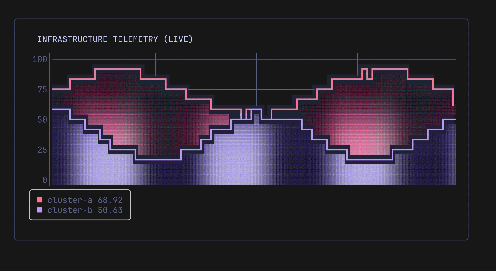

# Getting Started with Pulse

**Pulse** is a terminal line charting component built for [Lip Gloss](https://github.com/charmbracelet/lipgloss) and [Bubble Tea](https://github.com/charmbracelet/bubbletea).

## Installation

```bash
go get github.com/ingvarch/pulse
```

## Basic Usage

Create a new chart with `pulse.New(width, height, options...)`, push numeric values, and call `.View()` to produce the formatted string.

```go
package main

import (
	"fmt"
	"math"

	"github.com/ingvarch/pulse"
)

func main() {
	// Create a chart of 40 columns by 10 rows
	chart := pulse.New(40, 10,
		pulse.WithRange(0, 100),
		pulse.WithTicks(0, 25, 50, 75, 100),
		pulse.WithFill(true),
	)

	// Feed a sine wave
	for i := 0; i < 40; i++ {
		val := 50 + 40*math.Sin(float64(i)*0.4)
		chart.Push(val)
	}

	// Render to stdout
	fmt.Println(chart.View())
}
```

<p align="center">
  
</p>

## Sliding Window

The chart shows the last `w` points of each series. When you call `Push(val)` or `PushSeries(name, val)` beyond the width, older points roll off, creating a smooth real-time stream.

To query buffer lengths:
```go
totalPoints := chart.Len()             // Default series
cpuPoints   := chart.LenSeries("cpu")  // Named series
```

`Len`, `LenSeries`, `SeriesData` and `Last` work on the points in the window.

## History and Resizing

`SetSize(w, h)` changes the plot size. It clamps `w` and `h` to at least 1, like `New`, and keeps the data. A height change moves the tick rows. The X axis and the vertical grid follow the new width.

A series keeps up to `max(history, w)` points. Without `WithHistory` the history is 0, so the series keeps only the last `w` points: after a narrower chart is made wider again, the columns on the left stay empty. With a history, the points that left the window come back in the same columns relative to the newest point.

```go
chart := pulse.New(80, 12, pulse.WithHistory(500))

chart.SetSize(40, 12)  // draws the last 40 points
chart.SetSize(80, 12)  // draws the last 80 points again
chart.SetHistory(1000) // change the history later
```

`SetSize` and `SetHistory` drop the oldest points when the capacity gets smaller. A negative history counts as 0.

Events stay attached to their points. `VisibleEvents` returns the events inside the window. The chart removes an event only when it leaves the history, so an event that left a narrow window is back after widening.

## Missing Points

Push `math.NaN()` when a sample is missing. `NaN`, `+Inf` and `-Inf` are drawn as gaps: the series draws nothing in that column, and its line stops before the gap and starts again after it. Grid lines and event markers still show in a gap.

```go
chart.Push(42)
chart.Push(math.NaN()) // gap
chart.Push(45)
```

`Last(name)` skips trailing gaps and returns the last finite value. It returns `(0, false)` if the series has none, and `LegendBox()` then shows no value for it. `SeriesData(name)` returns the raw values, including `NaN` and `Inf`.

## Multi-Series Plotting

You can plot multiple concurrent time-series on the same coordinate space:

```go
chart.PushSeries("cpu", cpuUsage)
chart.PushSeries("mem", memUsage)
chart.PushSeries("net", netRps)
```

Each series can have its own Lip Gloss style:
```go
import "charm.land/lipgloss/v2"

chart.SetSeriesStyle("cpu", lipgloss.NewStyle().Foreground(lipgloss.Color("#ff5555")))
chart.SetSeriesStyle("mem", lipgloss.NewStyle().Foreground(lipgloss.Color("#50fa7b")))
```

## Styling and Themes

Series, axes and the legend take Lip Gloss styles, and `View()` returns a plain string, so the chart fits inside any Lip Gloss container. The `theme` package has a Tokyo Night preset: `preset.Axis` styles the axis, and `preset.LineFor(v)` picks a line color by value: green below 60, amber below 85, red from 85.

```go
package main

import (
	"fmt"

	"charm.land/lipgloss/v2"
	"github.com/ingvarch/pulse"
	"github.com/ingvarch/pulse/theme"
)

func main() {
	preset := theme.TokyoNight()

	chart := pulse.New(80, 13,
		pulse.WithRange(0, 100),
		pulse.WithTicks(0, 25, 50, 75, 100),
		pulse.WithLineWidth(2), // Bold curves: ┏ ┓ ┛ ┗
		pulse.WithAxisStyle(preset.Axis),
		pulse.WithSeriesStyle("cluster-a", preset.LineFor(88.0)), // red: 88 is above the critical level
		pulse.WithSeriesStyle("cluster-b", lipgloss.NewStyle().Foreground(lipgloss.Color("#bb9af7"))),
	)

	// Wrap the chart in a Lip Gloss bordered container
	box := lipgloss.NewStyle().
		Border(lipgloss.RoundedBorder()).
		BorderForeground(lipgloss.Color("#3b4261")).
		Padding(1, 2).
		Render(chart.View() + "\n" + chart.LegendBox())

	fmt.Println(box)
}
```

<p align="center">
  
</p>

## Legends and Value Inspection

Pulse provides built-in legend helpers:

```go
// Inline legend: ■ cpu  ■ mem
fmt.Println(chart.Legend())

// Boxed legend with live values and borders:
// ╭─────────────╮
// │ ■ cpu 88.67 │
// │ ■ mem 41.00 │
// ╰─────────────╯
fmt.Println(chart.LegendBox())

// Inspect the last pushed value:
if val, ok := chart.Last("cpu"); ok {
    fmt.Printf("Current CPU: %.2f%%\n", val)
}
```

## Dynamic Settings

All styling and rendering options can be modified dynamically at runtime:
```go
chart.SetSize(w, h)            // resize the plot, keeps the history
chart.SetHistory(n)            // keep up to n points per series
chart.SetGrid(true)            // toggle grid
chart.SetXAxis(label)          // time labels under the plot (View adds 2 lines)
chart.SetXAxisAt(label)        // time labels at the columns you choose
chart.SetFill(false)           // toggle shaded area fill
chart.SetLineWidth(2)          // switch between thin (1) and bold (2)
chart.SetMode(pulse.ModeBraille)// switch between ModeLines and ModeBraille
chart.ToggleRenderMode()       // flip between lines and braille
```
