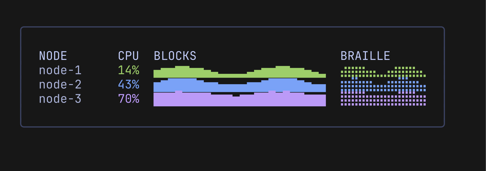

# Sparklines

A sparkline is a one-line trend for a table row or a list item, such as the CPU of each node. A full chart needs several rows and the axis labels. A sparkline is one row of text.

<p align="center">
  
</p>

## Usage

```go
cpu := []float64{12, 18, 35, 60, 82, 71, 44, 30}

fmt.Println(pulse.Sparkline(cpu, 0, 100))        // ▂▂▃▅▇▆▄▃
fmt.Println(pulse.SparklineBraille(cpu, 0, 100)) // ⣠⣴⣶⣤

// A table row: name, last value and the trend in the series style.
style := lipgloss.NewStyle().Foreground(lipgloss.Color("#9ece6a"))
chart := pulse.New(24, 1, pulse.WithRange(0, 100), pulse.WithSeriesStyle("cpu", style))
// ... chart.PushSeries("cpu", v) for each sample
last, _ := chart.Last("cpu")
row := fmt.Sprintf("%-8s %4.0f%%  %s", "node-1", last, chart.Sparkline("cpu"))
```

The functions return plain text. Style it yourself, or call the method, which uses the series style. Use fixed widths for the other columns, so the rows line up.

## Blocks

`Sparkline(values, min, max)` draws one cell per value with the eight blocks `▁▂▃▄▅▆▇█`. The block index is `round(norm * 7)`, where `norm` is the position of the value between `min` and `max`. So `min` draws `▁`, `max` draws `█`, and the middle of the range draws `▅`.

## Braille

`SparklineBraille(values, min, max)` draws two values per cell, so the same width shows twice the points. The first value of a pair uses the left dot column and the second the right one. Each value is a bar from the bottom of its column, one to four dots high: `1 + round(norm * 3)`. `min` lights the bottom dot and `max` all four.

A list of `n` values gives `ceil(n / 2)` cells. With an odd count the right column of the last cell stays empty.

## Rules for Both

- Values below `min` or above `max` are clamped.
- A gap (`NaN`, `+Inf`, `-Inf`) is a space. In braille a gap lights nothing in its column, and a cell where both columns are gaps is a space.
- `min` above `max` is swapped. Equal bounds work as `min..min+1`, as in `New`, so `5, 5.5, 6` between `5` and `5` give `▁▅█`.
- A bound that is `NaN` or infinite makes every cell a gap, so the result is spaces at the normal width.
- An empty or `nil` slice gives `""`.

## The Method

`(*Model).Sparkline(name)` draws a series of the chart the way `View` draws it, in the series style (`SeriesStyle(name)`). The name `""` is the default series. An unknown name, or a series without points, gives `""`.

- It draws the points the chart shows, one block per point, so it follows `SetOffset`. With auto range it updates `Min()` and `Max()` as `View` does. A chart of width `w` gives at most `w` cells.
- Range: the fixed range, or with [auto range](axes-and-grid.md#automatic-range) the range `View` would compute for the current data. You do not need to call `View` first.
- An inverted series is negated as in `View`.
- A series on the [right axis](axes-and-grid.md#right-axis) uses the range of that axis.
- On a [log scale](axes-and-grid.md#logarithmic-scale) a series on the left axis is placed by its logarithm in the drawn range. Values at or below zero are gaps.
- Thresholds, negative styles, threshold colors and the render mode do not apply. It always draws blocks in the series style.

For braille, pass `SeriesData(name)` and the range yourself to `SparklineBraille`.
