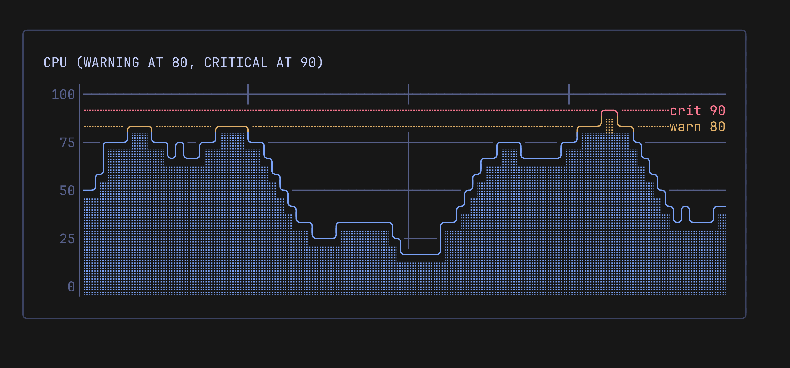

# Thresholds

Thresholds mark limits on the Y axis, such as a warning at 80 and a critical level at 90. A threshold can draw a dashed line with a label, and color the series where it reaches the limit.

```go
warn := lipgloss.NewStyle().Foreground(lipgloss.Color("#e0af68"))
crit := lipgloss.NewStyle().Foreground(lipgloss.Color("#f7768e"))

chart := pulse.New(80, 13,
	pulse.WithRange(0, 100),
	pulse.WithThresholds(
		pulse.Threshold{Value: 80, Style: warn, Label: "warn 80", Line: true},
		pulse.Threshold{Value: 90, Style: crit, Label: "crit 90", Line: true},
	),
	pulse.WithThresholdColors(true),
)
```

<p align="center">
  
</p>

## The Threshold Type

| Field | Meaning |
| ----- | ------- |
| `Value` | The Y value of the limit |
| `Style` | Color of the line and the label, and of the series at or above `Value` when threshold colors are on |
| `Label` | Text at the right end of the line. It needs `Line` |
| `Line` | Draws a dashed line (`┄`) at `Value` |

`WithThresholds` and `SetThresholds` replace the whole list. `SetThresholds` copies its arguments and ignores a threshold whose `Value` is NaN or infinite. `SetThresholds()` with no arguments removes all thresholds.

## Lines and Labels

- The line is on the row of its value, the same row a tick at that value gets.
- In draw order, front to back: the series, events, the threshold line, then the grid and the zero baseline. In a gap the line shows.
- Several thresholds on one row: the one with the highest `Value` wins. With equal values, the first in the list wins.
- A threshold outside `Min()` to `Max()` draws no line.
- The label is right-aligned at the end of the line, in the threshold style, and the series covers it like the line.
- A label wider than the plot width minus 2 cells is dropped and the line stays. Width is measured in terminal cells. ANSI codes in the label are stripped, and a label with a line break or another control character is dropped.
- A threshold without `Line` draws no label.

## Threshold Colors

`WithThresholdColors(true)` or `SetThresholdColors(true)` colors the series by the thresholds. `ThresholdColors()` returns the switch. It is off by default.

- A line or fill cell at or above a threshold's row takes the style of the highest threshold it reaches. Below all thresholds the series keeps its own style.
- Fill cells use the faint variant of the threshold style. With tinted fill, the tint comes from the threshold style.
- A negative style wins: a cell drawn below zero keeps the negative style of its series (`WithNegativeStyle`, `WithSeriesNegativeStyle`). Without one, the threshold applies.
- The switch is global. It applies to every series. A per-series option may come later.
- A threshold above `Max()` colors nothing. A threshold below `Min()` colors every row.
- The color is chosen per terminal row, in both modes, so a point in the same row as the limit takes its color.
- An inverted series is colored where it is drawn.

## Range

Thresholds do not change the Y range, also with [auto range](axes-and-grid.md#automatic-range). Set a range that holds them, or their lines do not show.

On a [log scale](axes-and-grid.md#logarithmic-scale) thresholds follow the log mapping, and a threshold with `Value <= 0` draws no line and colors nothing. The rules above use the drawn range, which can differ from `Min()` and `Max()`: with `WithRange(0, 1000)` the chart draws `100..1000`, so a threshold at 50 draws no line.

## Modes

Thresholds work in `ModeLines` and `ModeBraille`, with gaps, the zero baseline, the time axis and events.
